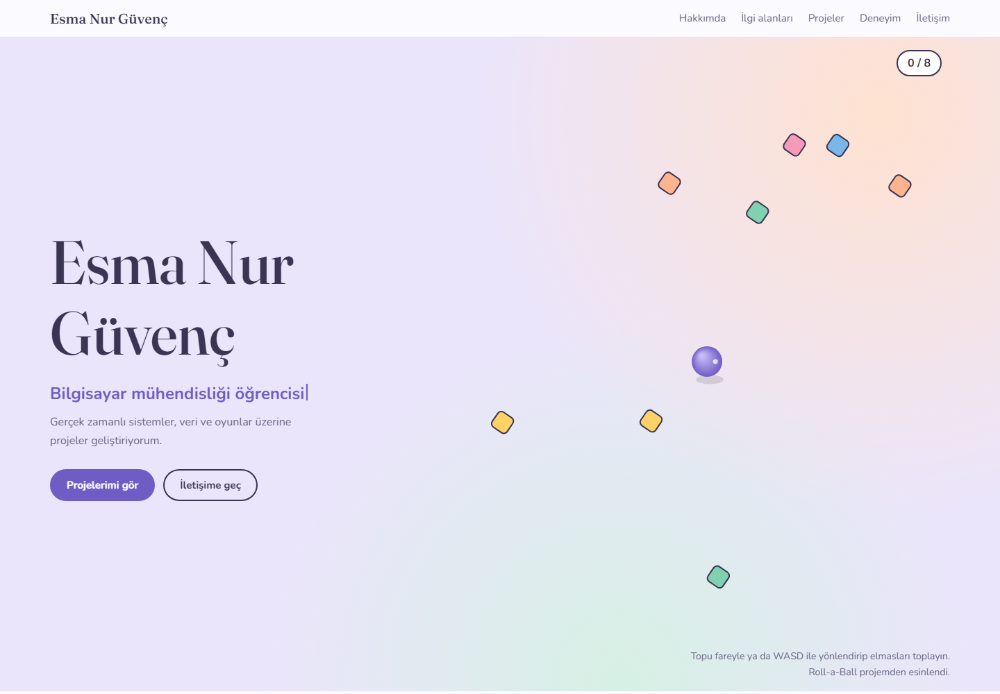

# Esma Nur Güvenç — Kişisel Portfolyo

Bilgisayar mühendisliği öğrencisi Esma Nur Güvenç'in projelerini, ilgi alanlarını, deneyimini ve eğitimini tanıtan kişisel web sitesi.

**Site:** https://esmaxp.github.io/esmanurguvenc-portfolio/

## Önizleme

## Özellikler

- Farklı ekran boyutlarına uyum sağlayan tasarım
- Canvas ile hazırlanmış, fare veya WASD tuşlarıyla oynanan mini oyun
- Kategorilere göre proje filtreleme
- Açılıp kapanan ilgi alanı kartları
- Animasyonlu başlık ve e-posta kopyalama
- Eğitim, deneyim, sertifikalar ve iletişim bağlantıları

## Kullanılan teknolojiler

HTML5, CSS3 ve JavaScript. Yazı tipleri Google Fonts üzerinden yüklenir. Derleme adımı veya paket kurulumu gerekmez.

## Yerelde açma

Depoyu indirin ve `index.html` dosyasını tarayıcıda açın. E-posta kopyalama özelliği, tarayıcının pano izinlerine ve güvenli bağlam desteğine bağlıdır.

## Yayınlama

Site GitHub Pages üzerinden, `main` dalının kök dizininden yayınlanır.

## İletişim

- [GitHub](https://github.com/Esmaxp)
- [E-posta](mailto:esmanurguvenc343@gmail.com)
